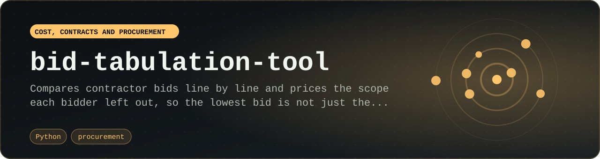
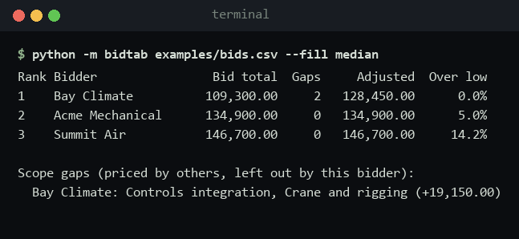

<p align="center"></p>

# bid-tabulation-tool

[](https://github.com/yassine2med/bid-tabulation-tool/actions/workflows/ci.yml)  

Compares contractor bids line by line and prices the scope each bidder left out, so the lowest bid is not just the most incomplete one.



## What it is for

When several contractors bid on the same job, the lowest total is often low because the bidder excluded items the others included, such as crane work or controls integration. A project engineer, estimator or procurement officer normally finds this by comparing spreadsheets side by side. This tool reads all bids from one CSV, finds the items each bidder left out, adds an estimated price for them, and ranks the bidders on the adjusted total.

## Install

```
git clone https://github.com/yassine2med/bid-tabulation-tool
cd bid-tabulation-tool
python -m pip install -r requirements.txt pytest
```

## How to use

| I want to | Command |
|---|---|
| Rank bids, filling gaps with the median price of other bidders | `python -m bidtab examples/bids.csv` |
| Fill gaps with the highest price any bidder gave | `python -m bidtab examples/bids.csv --fill max` |
| Compare raw totals with no adjustment | `python -m bidtab examples/bids.csv --fill none` |
| Get the result as JSON | `python -m bidtab examples/bids.csv --json` |

The CSV has three columns: bidder, item, amount. Write `excluded` or leave the amount empty when a bidder left an item out. An item counts as part of the scope when at least one bidder priced it.

Example with the invented bids in `examples/bids.csv`:

```
python -m bidtab examples/bids.csv
```

Output:

```
Rank Bidder                Bid total  Gaps     Adjusted  Over low
1    Bay Climate          109,300.00     2   128,450.00      0.0%
2    Acme Mechanical      134,900.00     0   134,900.00      5.0%
3    Summit Air           146,700.00     0   146,700.00     14.2%

Scope gaps (priced by others, left out by this bidder):
  Bay Climate: Controls integration, Crane and rigging (+19,150.00)
```

With `--fill none` the same file shows Acme Mechanical 23.4% above the low bid; after adjusting, the gap is 5.0%.

## How it works

- The scope is the set of all items priced by any bidder.
- For each item a bidder did not price, the tool takes the median (or max) of the other bids for that item.
- Adjusted total is the bid total plus those estimates. Bidders are ranked by adjusted total.
- Bad rows stop the run with the line number: bad amount, negative amount, duplicate item.

## Limits

The filled price is an estimate from the other bids, not a quote. With two bidders the median is their average. It does not read PDF bids, handle alternates or unit prices, or check bonding and qualifications.

MIT license. Yassine Emhamed, 2026.
